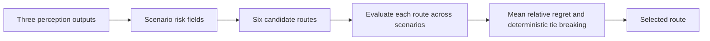
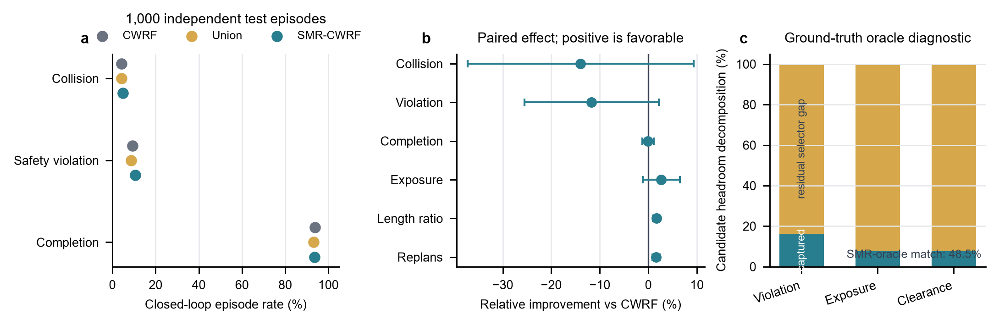

# SMR-CWRF: Route Selection under Perception Disagreement

[中文说明](README.zh-CN.md) · [Reproduction](docs/REPRODUCING.md) · [Evidence boundaries](docs/EVIDENCE.md)

**Research question:** When perception models disagree about obstacles, how can a
rover select a route without treating any one model as ground truth?

Research artifact accompanying **Scenario Mean-Regret Route Selection under
Perception-Ensemble Disagreement for Lunar Rover Planning** (CAC 2026 submission).
This archive does not assert acceptance, a DOI, or a published proceedings version.

## Method at a glance



The method retains perception disagreement until route selection. It chooses from
six fixed candidates using normalized mean relative regret. The frozen configuration
uses risk weight 15 and lambda=0. The historical function name
`select_minimax_regret` supports a broader family; **the paper method uses lambda=0**.

## Evidence

- 1,839 primary rendered-scene routes; five visual corruption conditions.
- 1,000 independently seeded procedural closed-loop scenarios, evaluated for seven methods.
- Paired statistics, selector-rule comparisons, and mechanism diagnostics.
- Shorter executed paths and fewer replans in the closed-loop comparison; **no established safety improvement**.
- The held-out real-lunar subset reverses the aggregate effect: **no cross-domain safety claim**.



| Closed-loop metric | CWRF | SMR-CWRF |
|---|---:|---:|
| Task completion | 93.7% | 93.6% |
| Collision | 4.3% | 4.9% |
| Safety-envelope violation | 9.4% | 10.5% |
| Mean normalized path length | 1.4607 | 1.4365 |
| Mean replans | 18.312 | 18.026 |

These are point estimates, not proof that every difference is significant.
See [paired confidence intervals](results/closed_loop/test/paired_statistics.csv).
The 2-D procedural simulator is **not** a lunar-physics simulator or a hardware trial.

## Quick start

Use Python 3.13, as in the local packaging check. From this repository root:

```bash
python -m venv .venv
# Activate .venv using your shell's activation command.
python -m pip install -r requirements.txt
python -m unittest discover -s tests -v
python tools/verify_results.py
python src/run_closed_loop_simulation.py --split validation --episodes 2 --seed 20260731 --bootstrap-samples 100 --contract CLOSED_LOOP_SIMULATION_CONTRACT_20260728.md --output-dir scratch/closed_loop_smoke
```

The smoke run checks executability, not the paper's effect size. Full evaluation and
static-image prerequisites are described in [REPRODUCING.md](docs/REPRODUCING.md).

## Repository contents

- `src/`: original selector, planning, simulation, and analysis code plus required helper modules.
- `tests/`: focused original tests for the selector, planner, paired statistics, and simulator.
- `results/`: frozen result tables and per-episode records; not newly generated claims.
- `assets/`: existing result figures, excluding lunar source imagery.
- `docs/`: method contracts, reproduction instructions, and interpretation limits.
- `tools/verify_results.py`: validate the exported closed-loop table against raw episode records.

No detector weights, source images, original manuscript, reviewer correspondence,
or private company data are included. See [rights and provenance](RIGHTS_AND_PROVENANCE.md).
