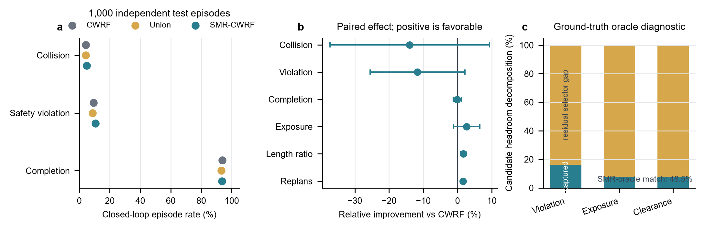

# SMR-CWRF：感知模型存在分歧时的月球车路线选择

[English](README.md) · [复现说明](docs/REPRODUCING.md) · [结论边界](docs/EVIDENCE.md)

## 一句话介绍

**多个模型看同一张图，却对障碍物意见不一致时，如何保留这些不同判断，选择一条相对稳健的路线？**

这是第一篇 CAC 2026 投稿工作的代码与证据整理。论文题目为
*Scenario Mean-Regret Route Selection under Perception-Ensemble Disagreement for Lunar Rover Planning*。
此仓库不声明论文录用状态、正式出版版本或 DOI。

## 主要工作

1. 保留三个感知模型各自的风险场，产生六条候选路线。
2. 在不同感知场景中交叉评价候选路线，采用平均相对后悔值及确定性规则进行选择。
3. 完成静态路线、图像腐蚀、选择规则消融、机理分析和程序化闭环评估。

已有证据包括 1,839 条主要渲染场景路线、五类图像腐蚀，以及七种方法在
1,000 个独立随机场景上的闭环测试。后者不是 7,000 个独立场景。

## 可以如何概括结果

**方法在闭环比较中表现为执行路径更短、重规划更少；没有证明安全性改善。**
真实月面留出子集还出现总体效果反转，因此不能把结果描述为已经具备跨域安全保证。
本工作属于已有位姿和地图配准基础上的决策层研究，不等于解决定位，也不是月球车实物或月面物理验证。

## 怎么使用

英文主页提供最小运行命令；详细步骤见 [复现说明](docs/REPRODUCING.md)。
代码、测试、原有结果表和图均已分类。原始图像、检测器权重、论文全文及审稿材料未包含。
源码函数历史名称含 `minimax`，但论文冻结方法使用 `lambda=0`，即平均相对后悔值。

源码保留原始实现；整理仓库不会改动原研究目录。开放许可尚未指定，详见
[权利及来源说明](RIGHTS_AND_PROVENANCE.md)。
